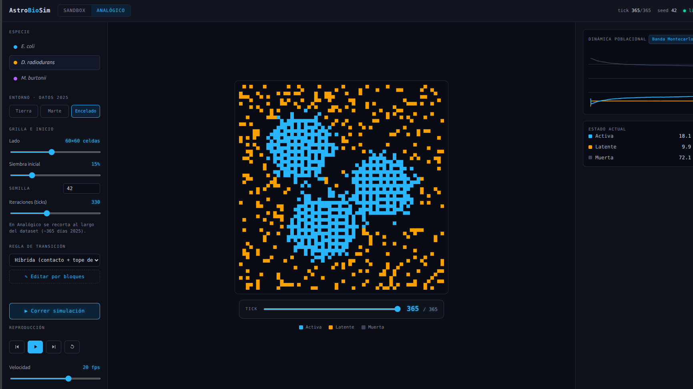

# AstroBioSim

An interactive Python-based simulator that models the population viability of microorganisms in the subsurface environments of Earth, Mars, and Enceladus using cellular automata, evaluating their survival in relation to three critical variables: temperature (T), radiation (R), and water activity (A_w).

Final Project — 1st Winter School on Computational Methods.

## Architecture

...
